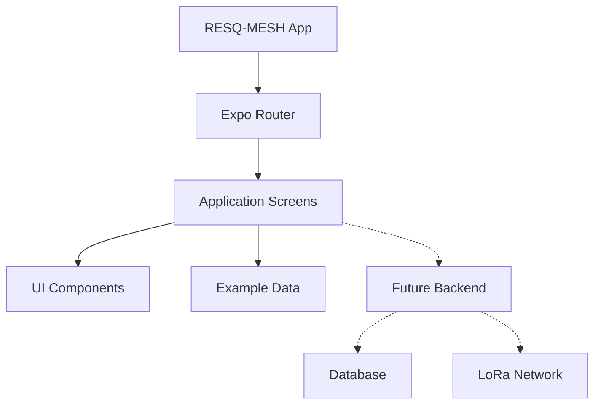

# RESQ-MESH Mobile

## About the Project

RESQ-MESH is a mobile application designed to help people in emergency situations in areas without cellular coverage, such as Bosque La Primavera.

This project focuses on creating the screens and navigation of the application using React Native and Expo.

For now, the application uses example data and does not have a backend or database.

## Technologies

-React Native
-Expo
-Expo Router
- TypeScript
-GitHub

## Project Structure

- src/app: Contains the application screens and navigation.
- src/components: Reusable components.
- src/constants: Application settings and constants.
- src/hooks: Custom React hooks.
- assets: Images and other resources.

## Application Screens

1. Login
2. Dashboard
3. Active Alerts
4. Alert Details
5. GPS Map
6. Node Status
7. Node Details
8. Alert History
9. Administration
10. Update Incident
11. Device Administration

## Navigation

We chose Expo Router because it is easy to use and organizes navigation through files and folders.

Each screen has its own file, making the application easier to understand and modify.

## Architecture




```

## Design Decisions

- React Native allows us to develop a mobile application for Android and iOS.
- Expo makes development and testing easier.
- Expo Router helps organize the screens and navigation.
- TypeScript helps prevent programming errors.
- Example data allows us to test the application without a backend.

## How to Run

1. Download or clone the repository.
2. Open the project in VS Code.
3. Install dependencies:

```bash
npm install
```

4. Start the application:

```bash
npx expo start
```

5. Press W to open the application in a browser.

## Current Features

- Navigate between screens.
- View emergency alerts.
- Check node information.
- View example GPS locations.
- Filter alert history.
- Simulate incident updates.
- Enable and disable devices.

## Future Improvements

- Connect a backend and database.
- Add real GPS maps.
- Connect LoRa devices.
- Add real user authentication.
- Receive emergency alerts in real time.

## Purpose

This repository was created for the Mobile Development course.

The goal is to implement the screens and navigation designed in the previous assignment, without using backend services yet.
